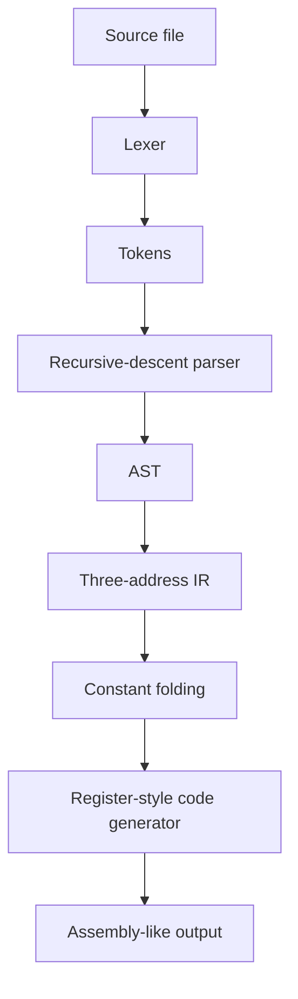

# MiniCompiler

MiniCompiler is a small C++17 educational compiler for an arithmetic assignment language. It demonstrates a classic compiler pipeline: lexical analysis, recursive-descent parsing, AST construction, intermediate representation (IR), constant folding, and custom register-style code generation.

> **Scope note:** `LOAD`, `ADD`, `MUL`, and `STORE` output is a simplified custom assembly-like format, not machine code. The optional `--ptx-preview` output is a learning scaffold, **not verified, executable PTX**. Real PTX generation requires correct constant materialization, variable memory layout, ABI/kernel parameters, and validation with NVIDIA's tools.

## Features

- C++17, CMake, no third-party dependencies
- Lexer with source locations and diagnostics
- Recursive-descent parser with precedence (`*` and `/` before `+` and `-`)
- AST node types for numbers, variables, unary minus, and binary arithmetic
- Three-address IR with temporaries
- Conservative constant folding with overflow and division-by-zero safeguards
- Custom register-style assembly output
- Token, IR, assembly, and PTX-preview modes
- Automated unit tests through CTest

## Build

### Windows (Visual Studio Build Tools)

Open **Developer PowerShell for VS** in this directory:

```powershell
cmake -S . -B build
cmake --build build --config Debug
ctest --test-dir build -C Debug --output-on-failure
```

Run the compiler:

```powershell
.\build\Debug\minicompiler.exe examples\basic.mc --tokens
.\build\Debug\minicompiler.exe examples\basic.mc --ir
.\build\Debug\minicompiler.exe examples\basic.mc --asm
.\build\Debug\minicompiler.exe examples\basic.mc --ptx-preview
```

If using MSYS2/MinGW with Ninja, install GCC, CMake, and Ninja, open the **UCRT64** shell, and run:

```bash
cmake -S . -B build -G Ninja
cmake --build build
ctest --test-dir build --output-on-failure
./build/minicompiler examples/basic.mc --asm
```

### Linux

```bash
sudo apt install build-essential cmake git
cmake -S . -B build
cmake --build build
ctest --test-dir build --output-on-failure
./build/minicompiler examples/basic.mc --asm
```

## Language example

Input (`examples/basic.mc`):

```text
a = (b + c) * 2;
x = 2 * 3 + 4;
```

Inspect the IR:

```text
 t1 = b
 t2 = c
 t3 = t1 + t2
 t4 = 2
 t5 = t3 * t4
 a = t5
 ...
```

Exact temporary numbering follows the compiler implementation. `--asm` applies constant folding before code generation. The language currently supports integer literals, identifiers, `+ - * /`, unary `+/-`, parentheses, assignment, and semicolon-terminated statements.

## Pipeline



## Command-line modes

- `--tokens`: print tokens and source locations
- `--ast`: parse and confirm AST construction (AST pretty-printing is not implemented)
- `--ir`: print three-address IR
- `--asm`: optimized custom assembly-like output (default)
- `--ptx-preview`: experimental PTX-oriented preview; not validated or executable

## Tests

```bash
ctest --test-dir build --output-on-failure
```

Tests cover tokenization, malformed tokens, parsing and syntax errors, IR generation, constant folding, and code generation.

## Limitations and future work

- No types, declarations, control flow, or functions
- No execution engine for the custom output
- No AST pretty-printer yet
- Constant folding is conservative and doesn't propagate constants through all variable assignments
- PTX preview is intentionally incomplete and must not be described as a real PTX backend
- Future work: add AST visualization, a typed IR, register allocation, a verified PTX backend, and integration tests with `ptxas`

## Skills demonstrated

C++17, lexical analysis, parsing, AST design, intermediate representations, compiler passes, integer-overflow-aware optimization, diagnostics, CMake, unit testing, and code generation.

## References

- [LLVM Kaleidoscope tutorial](https://llvm.org/docs/tutorial/)
- [NVIDIA PTX ISA documentation](https://docs.nvidia.com/cuda/parallel-thread-execution/)
